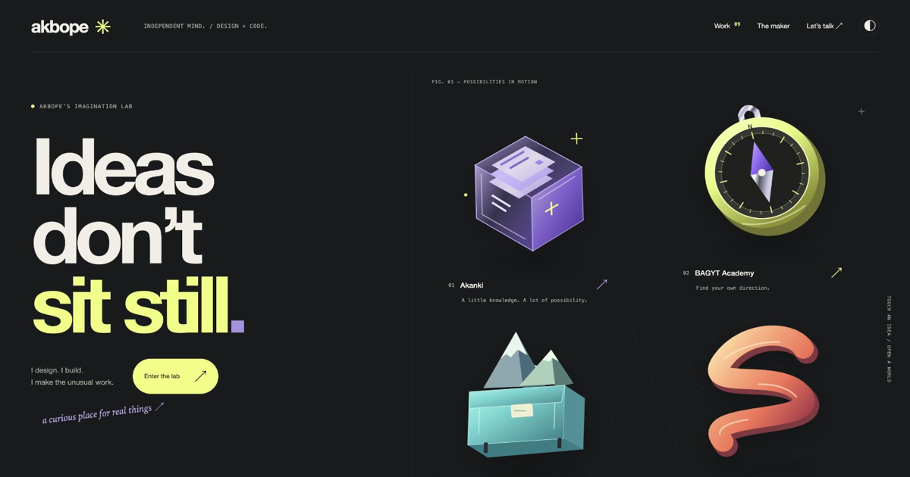

# Akbope - product design and full-stack portfolio

[Live portfolio](https://akiboupie.vercel.app/) · [Download CV](https://akiboupie.vercel.app/akbope-detailed-cv.pdf)



A fullscreen, interactive 3D fantasy meadow, built with Three.js. The current art direction uses a shared four-step cel-shading ramp, a painted blue sky, sculpted clouds, layered cliffs, ivory-and-timber cottages, luminous elemental glass, ruins and a floating crystal waystone. All geometry is authored locally. The chest and portfolio objects remain interactive.

The meadow includes: large colorful flower beds, butterflies, grass, distant trees, a winding stone path, and an ornamental сандық at the center. Opening the chest moves the camera into an overhead inspection view; the letter, journal, and envelope rest inside its lined interior and can be selected directly. Flower beds are sparse, with roughly 70% fewer blooms. The countryside includes six distinct flower forms, ferns, reeds, wheat, mushrooms, a pond, a stone arch, a cart, full-size two-storey cottages, distant towers and a windmill. Textured hills carry surface-aligned woodland, shrubs, boulders and winding trails; tree roots and grass follow the actual hill height rather than being buried inside it. Surrounding buildings and props are decorative. Games, garden progression and village utilities have been removed; the chest provides access to the biography, projects and contact details.

## Selected work

The journal includes nine projects. Three working products have detailed engineering evidence:

1. **Focus10** - full-stack productivity product with a guest workspace, PostgreSQL integrity constraints, RFC 4180 export and 127 automated tests.
2. **Agylshyn** - bilingual learning system covering 13 books, 937 units or test sections and 21,562 tracked questions.
3. **Mountain** - private multi-format reader with contextual Kazakh translation, vocabulary review, full-text search and device linking.

The journal includes Akanki, JORYQ Travel, MammaMia! Studio and BAGYT Academy, with screenshots, live links and case studies matching the updated PDFs. Travel demos and fictional businesses are labelled explicitly.

DOS Optics is clearly labelled as an independent concept and AIELTS as an experimental responsible-AI product.

## Portfolio structure

```text
src/main.jsx       routing, homepage sections and case-study components
src/projects.js    project evidence, metrics, links and offer definitions
src/additionalProjects.js  newer project case studies from the updated PDFs
src/styles.css     base responsive layouts
src/Meadow.jsx     meadow controls, paper letter, project journal and contact
src/meadowScene.js Three.js scenery, chest, movement, picking and animation
src/fantasyArt.js shared cel shading, gradient sky, clouds, cliffs and elemental scenery
src/meadowDetails.js instanced plants, countryside props and interactive keepsakes
src/HouseGame.jsx  full-screen 3D house-game lifecycle and accessible controls
src/RoomArtifact.jsx rolled biography and themed project detail dialogs
src/meadow.css     responsive meadow and portfolio controls
src/TreasureBook.jsx illustrated book, keyboard/swipe navigation and page turns
src/treasures.css  parchment, leather binding, unfolding and turning animations
public/textures/  locally authored paper surface
src/studio.css     shared case-study styling
public/projects/   primary project covers
public/evidence/   authentic product screens used in case studies
scripts/           reproducible portfolio and CV PDF builders
output/pdf/        generated PDF deliverables
```

Each case study follows the same evidence-oriented sequence: challenge, responsibility, constraints, key decisions, annotated screens, system flow, validation, outcome and reflection. Claims are limited to shipped capabilities, audited content and documented tests; the site does not invent customer metrics or testimonials.

## Local setup

```bash
npm install
npm run dev
```

Production checks:

```bash
npm run check
npm run build
```

Vercel uses `npm run build`, publishes `dist`, and applies the client-side route rewrite in `vercel.json`.

## Content and asset updates

- Edit case-study copy, evidence and links in `src/projects.js`.
- Keep authentic screenshots in `public/evidence/` and include explicit dimensions in markup.
- Update both `public/og-image.svg` and its 1200x630 rendered `public/og-image.png` when positioning changes.
- Rebuild `output/pdf/akbope-portfolio.pdf` with `scripts/build_portfolio_pdf.py` after material portfolio edits.
- The same builder writes the landscape `akbope-product-fullstack-portfolio.pdf` and one-page `akbope-resume.pdf`; verified project screens live in `public/evidence/`.
- Keep working products, independent concepts and experimental products explicitly labelled.

## Remaining owner-supplied items

- Add a confirmed professional email to the contact section and structured data.
- Add real testimonials only after receiving permission from a client or collaborator.
- Add 45-60 second walkthrough videos for Focus10 and Agylshyn when recordings are available.

No analytics, secrets, fabricated testimonials or unverified business results are included.

## Font credit

MedievalSharp by Wojciech Kalinowski is self-hosted from the [Google Fonts repository](https://github.com/google/fonts/tree/main/ofl/medievalsharp) under the SIL Open Font License. The license is included at `public/fonts/MedievalSharp-OFL.txt`.

## Languages and typography

The website defaults to Kazakh and supports English via the KK / EN control, including portfolio case studies, accessible controls and text drawn in the 3D scenes. Language is saved under `akbope-language`; `?lang=kk` and `?lang=en` override it for shareable links. Changing language reloads the scene and preserves the open panel; portfolio content stays accessible in either language. Project screenshots and downloaded CV files retain their source language. System sans-serif fonts support Kazakh and Latin without remote font requests.

Run `node --test scripts/i18n.test.mjs` for locale, project-coverage and persistence checks.

The meadow flowers use six sculpted bloom styles with stems and rounded leaves. Click or tap a flower head to release dust in its petal color. Flower picking respects nearer interactive objects, uses a fixed 384-particle pool, and reduces the burst to a stationary fade when reduced motion is enabled. Run `node --test scripts/meadowFlowers.test.mjs` to check picking, color matching, particle limits and fading.
